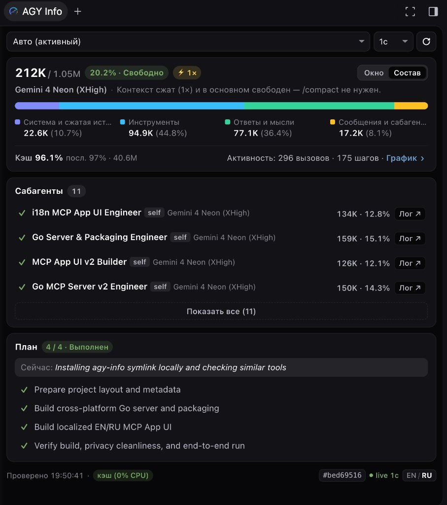
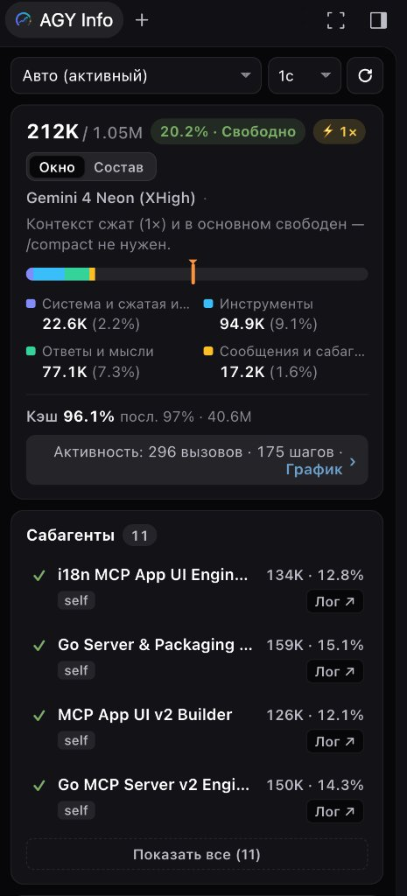
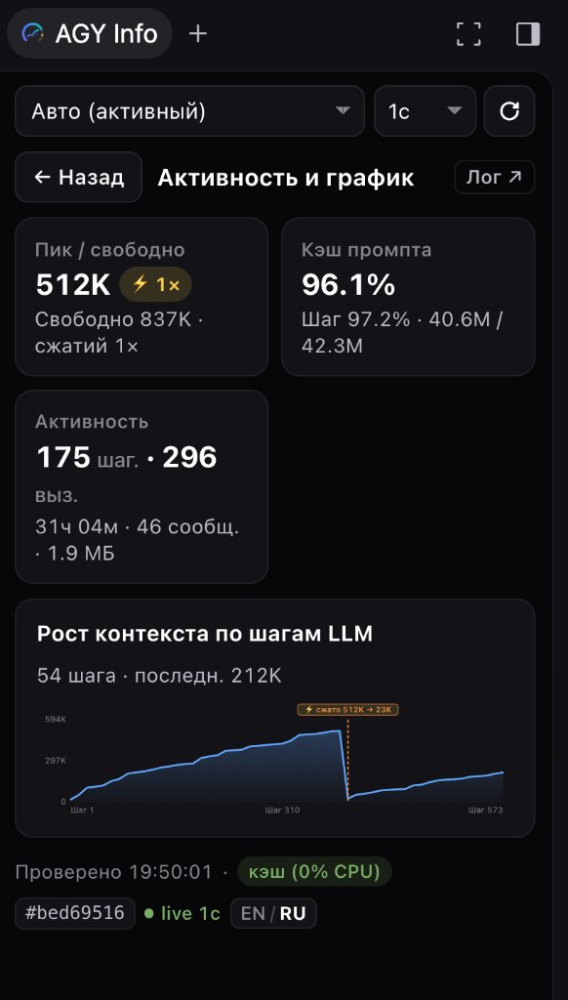

[English](./README.md) | **Русский**

# AGY Info

Лёгкий полностью локальный плагин MCP App для **Google Antigravity**, который в реальном времени показывает состояние текущей сессии агента: заполнение контекстного окна, работающих сабагентов, актуальный план выполнения и график роста токенов — с нагрузкой ~0% CPU и нулевым расходом токенов LLM.

Плагин работает нативно и в **правой боковой панели (`aux_pane`)**, и в **левом сайдбаре (`global`)**.

## Скриншоты

<p align="center">
  
</p>

<p align="center">
  
  &nbsp;
  
</p>

## Возможности

- **Объединённый индикатор контекста (`Окно` / `Состав`)**
  - Текущее заполнение окна (`занято / лимит`, процент, свободный запас) с цветовой подсказкой, пора ли запускать `/compact`.
  - Маркеры пикового объёма и компактинга (`CHECKPOINT`) прямо на шкале, плюс процент попаданий в prompt cache.
  - Переключение между видом **Окно** и **Состав** (базовый системный контекст/сводка, выводы инструментов, ответы и мысли агента, сообщения пользователя и сабагентов).
- **Инспектор живых сабагентов**
  - Отслеживает всех сабагентов, запущенных в сессии: статус (`running`, `done`, `idle`, `stopped`), модель, заполнение контекста, число шагов и вызовов инструментов, а также текущий фокус (`update_focus`) или выполняемый инструмент.
  - По клику можно провалиться внутрь сессии сабагента (и вернуться к родительской), либо открыть файл лога транскрипта.
- **Живой чеклист плана и фокус**
  - Показывает актуальный список шагов из `update_steps` и текущий фокус из `update_focus`.
  - Если `update_steps` не вызывался, автоматически подхватывает чеклист из корневых markdown-артефактов (`task.md`, `implementation_plan.md`, `plan.md`) со ссылкой на открытие файла.
- **Экран «Активность и график»**
  - Пошаговый график роста контекста с отметками компактинга, накопительная статистика токенов за всю сессию, эффективность кэша и счётчики ходов, шагов LLM и инструментов.
- **Живое обновление раз в секунду при ~0% CPU**
  - Кэширование по `mtime`/`size`, TTL 5 секунд на сканирование каталога и хэш ревизии позволяют отдавать минимальный ответ `unchanged: true` (~159 байт), пока данные не изменились.
  - Автоматическая пауза опроса, когда вкладка панели скрыта.
- **Переключатель языка EN / RU**
  - Мгновенное переключение интерфейса между английским и русским языками.
- **100% локально и приватно**
  - Единый автономный файл интерфейса (`assets/app.html`) без внешних запросов и телеметрии, нулевые внешние зависимости в Go и ноль потраченных токенов LLM на мониторинг.

## Быстрая установка

### Способ 1: клонировать прямо в папку плагинов Antigravity

```bash
git clone https://github.com/mterebov/agy-info.git ~/.gemini/config/plugins/agy-info
```

При первом запуске `scripts/run.sh` сам соберёт `bin/agy-info` через Go 1.22+ (внешние пакеты не требуются), либо автоматически скачает готовый бинарник из [GitHub Releases](https://github.com/mterebov/agy-info/releases), если Go не установлен.

### Способ 2: клонировать в любую папку и запустить установщик

```bash
git clone https://github.com/mterebov/agy-info.git
cd agy-info
./scripts/install.sh
```

Для разработки удобно ставить симлинком без копирования:

```bash
./scripts/install.sh --symlink
```

### Как открыть AGY Info в Antigravity

1. Включите **AGY Info** в **Plugins Manager** (или перезагрузите Antigravity).
2. Откройте панель через кнопку **`+`** в правой боковой панели или в левом сайдбаре в разделе **AGY Info**.
3. Также можно написать агенту: *«Открой AGY Info для текущей сессии»*.

> **Если Go не установлен:** `scripts/run.sh` при первом запуске сам скачает готовый бинарник под вашу ОС и архитектуру из [GitHub Releases](https://github.com/mterebov/agy-info/releases), либо вы можете положить его вручную в `~/.gemini/config/plugins/agy-info/bin/agy-info`.

## Разработка и сборка

Требования: **Go 1.22+** (сервер) и **Node.js 20+** (интерфейс).

```bash
make build          # Собрать Go MCP-сервер -> bin/agy-info
make test           # Запустить тесты Go с детектором гонок (-race)
make vet            # Проверить код через go vet
make ui             # Собрать single-file UI -> assets/app.html
make install        # Установить плагин в ~/.gemini/config/plugins/agy-info
make release-bins   # Кросс-сборка под macOS, Linux и Windows -> dist/
make clean          # Удалить bin/ и dist/
```

## Архитектура

```text
Antigravity Host (aux_pane / global sidebar)
   │  stdio JSON-RPC 2.0 (MCP)
   ▼
scripts/run.sh ──exec──▶ bin/agy-info (Go stdlib MCP-сервер)
   ├── Читает ~/.gemini/antigravity/brain/<conversation-id>/
   │     ├── .system_generated/logs/transcript[_full].jsonl
   │     └── task.md / implementation_plan.md / plan.md
   ├── Опциональный опрос живых статусов локального LS (при наличии env-переменных)
   ├── Предоставляет MCP-инструменты:
   │     ├── open_agy_info          (точка входа UI, всегда полный снимок)
   │     └── get_context_snapshot   (app-only опрос с быстрым unchanged: true)
   └── Отдаёт ресурс UI:
         └── ui://agy-info/app.html ──▶ assets/app.html (автономный MCP App)
```

## Лицензия

[MIT](./LICENSE) © 2026 Maksim Terebov
